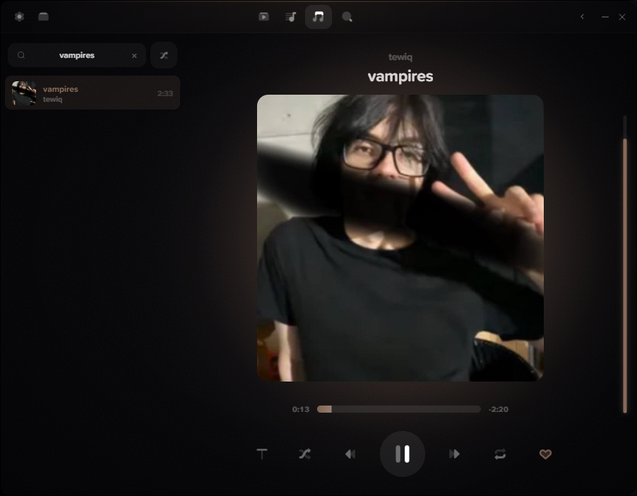

# seWer

Музыкальный плеер для Windows. SoundCloud и локальная музыка в одной библиотеке.

**[Скачать для Windows](https://github.com/despoyledporcelain/sewer-tauri/releases/latest)** · Windows 10 и 11 · x64



## Возможности

- **SoundCloud** · лайки, поиск, плейлисты и загрузка треков.
- **Воспроизведение** · эквалайзер, кроссфейд, скорость и тон, тексты песен.
- **Комнаты** · совместное прослушивание с синхронизацией.
- **Интеграция с Windows и Discord** · трей, горячие клавиши и Rich Presence.

## Разработка

Tauri v2, React и Rust. Для сборки нужны Node.js 18+, Rust и MSVC Build Tools.

```powershell
npm ci
npm run app:dev
```

`npm test` запускает тесты. `npm run app:build` собирает установщик.
